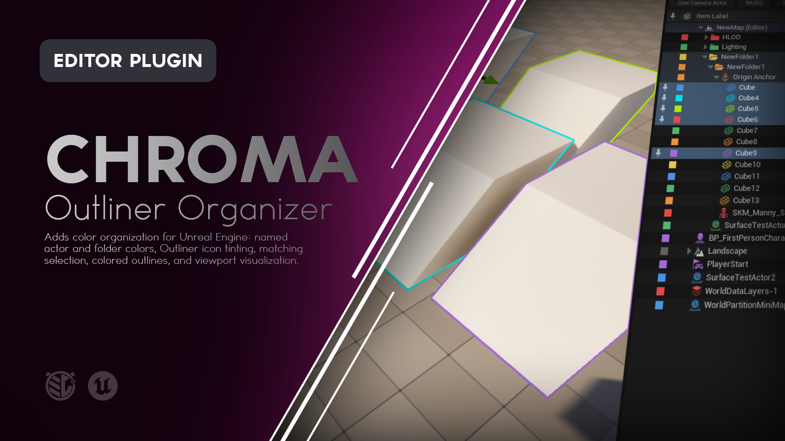
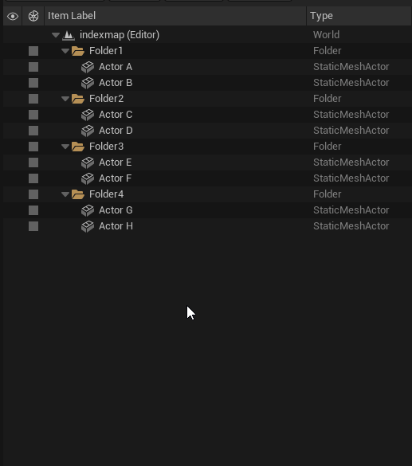
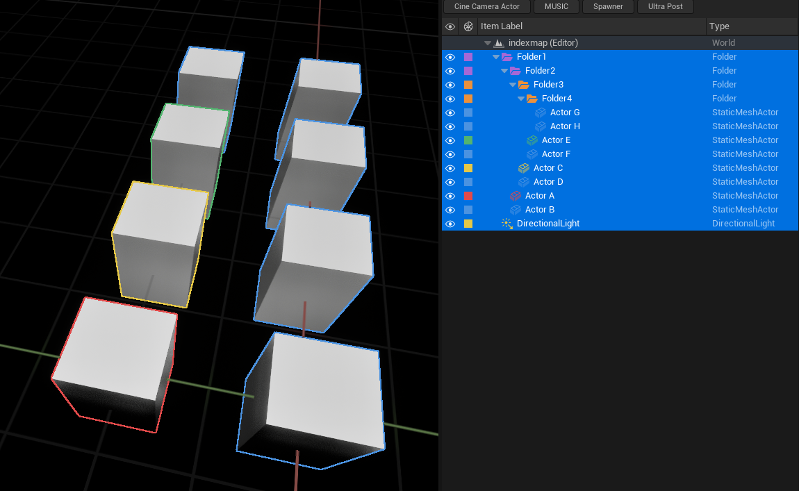

# Chroma

**Give your Unreal Engine levels a color language.**

Organize Actors and Folders with meaningful colors directly in the World Outliner. Find related content faster, recognize important objects at a glance, and see your level's organization in the viewport—without changing the materials, transforms, or gameplay of the Actors you're working with.

    

---

## Your Outliner tells you where things are. Chroma shows you what they belong to.

A large level can have hundreds or thousands of Actors. Even with folders and sensible names, visually separating environment art from gameplay, lighting, audio, and objects that deserve special attention takes work.

Chroma adds a small, familiar **color swatch next to each Actor or Folder**. Assign a named project color, give a particular item its own override, or let an entire folder hierarchy inherit a shared color.

For example, you might use **Green** for Environment, **Orange** for Gameplay, **Yellow** for Lighting, **Purple** for Audio, **Blue** for Player, and **Red** for Critical content. They're your categories, not hardcoded rules.

**The result:** a more readable World Outliner, faster visual identification, and a shared way for your team to understand a level.

## See Chroma in action

### Color a folder. Organize everything inside it.

Assign a color to an Actor or Folder with a click. Folders pass their color down to their contents and nested folders until an item chooses a different color. Even new Actors placed in that folder inherit its color.

*Assign named or custom colors from the World Outliner without leaving your normal editing workflow.*

*Folder inheritance gives an entire branch a consistent identity while still allowing individual overrides.*

Create **named project colors** that represent actual team concepts—not just RGB values. If you rename or recolor a named preset later, its assigned items retain the same preset identity. Use a **custom color** for one-off needs, **Clear Override** to resume inheritance, or **No Color** to intentionally block it.

[Explore colors and inheritance](https://mippi-the-dork.github.io/Chroma/?page=02-colors-and-inheritance%2FREADME.md) · [Named Project Palette](https://mippi-the-dork.github.io/Chroma/?page=02-colors-and-inheritance%2Fpalette%2FDESIGN.md) · [Overrides and No Color](https://mippi-the-dork.github.io/Chroma/?page=02-colors-and-inheritance%2Foverrides%2FDESIGN.md)

### Your colors can select things, too.

Color isn't only decorative. Choose **Select Matching Color** to collect loaded Actors and compatible Folder rows that share a color assignment, or **Select Matching Color Among Siblings** to narrow the search to their immediate Outliner parent. Hold **Shift** to add matches to your selection.

Chroma also supports bulk coloring of selected items, Copy/Paste that preserves named color assignments, and a Chroma submenu in compatible Actor context menus.

*Use a shared color assignment to gather related level content without relying on naming conventions.*

[Matching Selection](https://mippi-the-dork.github.io/Chroma/?page=03-selection-and-outliner%2Fmatching%2FDESIGN.md) · [Multi-Selection Editing](https://mippi-the-dork.github.io/Chroma/?page=03-selection-and-outliner%2Fbatch%2FDESIGN.md) · [Copy and Paste](https://mippi-the-dork.github.io/Chroma/?page=03-selection-and-outliner%2Fclipboard%2FDESIGN.md)

### Make your viewport show the organization.

Chroma can tint compatible **Outliner Actor and Folder icons** and give selected Actors **color-coded selection outlines**. Want to survey the entire level? Switch the viewport to **Actor Coloration → Chroma** and see supported geometry in its effective organizational color.

| Normal Lit view | Chroma Actor Coloration |
| :---: | :---: |
|  |  |

*The same scene, viewed through its materials on the left and its organizational colors on the right.*

*Selection outlines can reinforce the meaning of colors while you work directly in the level.*

In Chroma visualization mode, the **viewport color inspector** lets you hover supported geometry to see the Actor name, color, hex value, and where that assignment came from.

[Colored Selection Outlines](https://mippi-the-dork.github.io/Chroma/?page=04-viewport%2Foutlines%2FDESIGN.md) · [Actor Coloration](https://mippi-the-dork.github.io/Chroma/?page=04-viewport%2Fvisualization%2FDESIGN.md) · [Viewport Color Inspector](https://mippi-the-dork.github.io/Chroma/?page=04-viewport%2Finspector%2FDESIGN.md)

---

## Full documentation

### **[Explore the Chroma Documentation Website](https://mippi-the-dork.github.io/Chroma/)**

The dedicated documentation covers every major feature, step-by-step workflows, source-backed technical behavior, saving and source control, limitations, and troubleshooting. Each topic includes separate **Design** and **Technical** guides, with screenshots and planned visual demonstrations.

**Popular starting points**

| Looking for… | Start here |
| --- | --- |
| Installing Chroma | [Installation and Compatibility](https://mippi-the-dork.github.io/Chroma/?page=01-getting-started%2Finstall%2FDESIGN.md) |
| Getting up and running | [Your First Color Workflow](https://mippi-the-dork.github.io/Chroma/?page=01-getting-started%2Ffirst-use%2FDESIGN.md) |
| Folder colors, inheritance, and overrides | [Colors and Inheritance](https://mippi-the-dork.github.io/Chroma/?page=02-colors-and-inheritance%2FREADME.md) |
| Organizing and selecting by color | [Selection and Outliner](https://mippi-the-dork.github.io/Chroma/?page=03-selection-and-outliner%2FREADME.md) |
| Viewport overlays and visualization | [Viewport Presentation](https://mippi-the-dork.github.io/Chroma/?page=04-viewport%2FREADME.md) |
| Project configuration | [Project Settings](https://mippi-the-dork.github.io/Chroma/?page=05-settings-and-support%2Fsettings%2FDESIGN.md) |
| Saving and team workflows | [Saving and Team Workflows](https://mippi-the-dork.github.io/Chroma/?page=05-settings-and-support%2Fsaving%2FDESIGN.md) |
| How the plugin works | [Implementation and API](https://mippi-the-dork.github.io/Chroma/?page=05-settings-and-support%2Farchitecture%2FTECHNICAL.md) |
| When something doesn't behave as expected | [Troubleshooting and FAQ](https://mippi-the-dork.github.io/Chroma/?page=05-settings-and-support%2Ftroubleshooting%2FDESIGN.md) |

---

## Compatibility and getting Chroma

**Chroma v1.0.1** targets **Unreal Engine 5.8.x**, **Windows 64-bit**, and the **Unreal Editor**. The repository documents testing on Unreal Engine **5.8.2**. Chroma is editor-only, with no runtime Actor or Component dependency.

- [GitHub Releases](https://github.com/mippi-the-dork/Chroma/releases) — check for a compatible precompiled build when available.
- [Chroma source code](https://github.com/mippi-the-dork/Chroma) — for developers who want to build the plugin.
- [Installation instructions](https://mippi-the-dork.github.io/Chroma/?page=01-getting-started%2Finstall%2FDESIGN.md) — Fab availability, installation paths, source builds, and compatibility details.

*Fab and precompiled release availability should be checked on their respective listings; a source archive is not necessarily a precompiled plugin.*

## What Chroma doesn't do

Chroma is a **visual organization tool for the Unreal Editor**, not a gameplay or material system.

- It does **not** change Actor materials, geometry, transforms, visibility, attachment relationships, or Folder hierarchy.
- It does **not** add runtime Actors or Components, change packaged-game visuals, or replicate colors into gameplay.
- Its folder-color inheritance follows **World Outliner folders**, not attachment relationships.
- Color editing, matching, and used-color collection work on **loaded editor content**; unloaded World Partition Actors are not included.
- Outliner filters can prevent hidden matching **Folder rows** from being selected, although filtered Actors can still be matched.
- Colored selection outlines support up to **six additional distinct colors** when available; unsupported or specialized rendering paths may use Unreal's ordinary outline.
- Tinted icons and Actor Coloration depend on compatible native editor widgets and supported rendered geometry. Empty Actors and Folders have no viewport geometry to recolor.
- Chroma does not automatically check out, submit, sync, or merge source-control files. Save and share the affected packages and palette configuration through your usual project workflow.

For detailed behavior and known edge cases, see the [documentation's troubleshooting and limitations](https://mippi-the-dork.github.io/Chroma/?page=05-settings-and-support%2Ftroubleshooting%2FDESIGN.md).

---

## Bugs, feature requests, and contributions

**Found a bug?** [Open an issue](https://github.com/mippi-the-dork/Chroma/issues/new). Include the Chroma and Unreal Engine versions, the installation method, whether Actors or Folders are involved, exact reproduction steps, relevant Outliner/World Partition context, screenshots or video, and Unreal Editor logs where useful. For inheritance issues, a small Folder hierarchy example is especially helpful.

**Have an idea?** [Request a feature](https://github.com/mippi-the-dork/Chroma/issues/new) and describe the *organizational problem* you're trying to solve. That makes it easier to assess whether the improvement belongs in Chroma and what the simplest useful solution might be.

**Want to contribute?** Pull requests are welcome. For significant changes, [open an issue first](https://github.com/mippi-the-dork/Chroma/issues) so the expected behavior can be discussed before major implementation work. Chroma's focus remains color-based editor organization, selection, and visualization.

## License

Chroma is released under the **MIT License**. See [LICENSE](LICENSE) for the complete terms.

---

**Chroma** is created by **Mippi the Dork**.

**[Read the documentation](https://mippi-the-dork.github.io/Chroma/)** · **[View the source](https://github.com/mippi-the-dork/Chroma)** · **[Report an issue](https://github.com/mippi-the-dork/Chroma/issues)**
