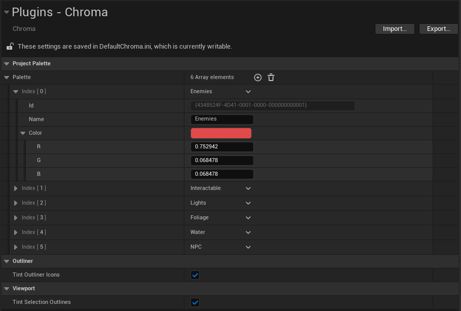
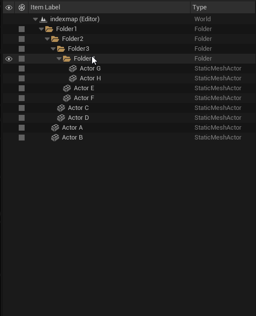
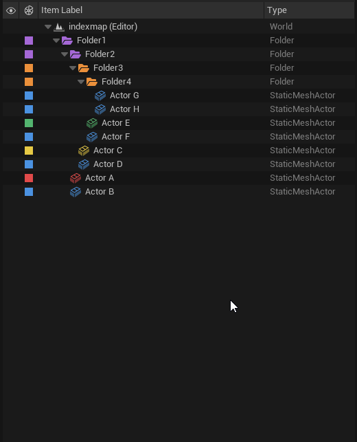
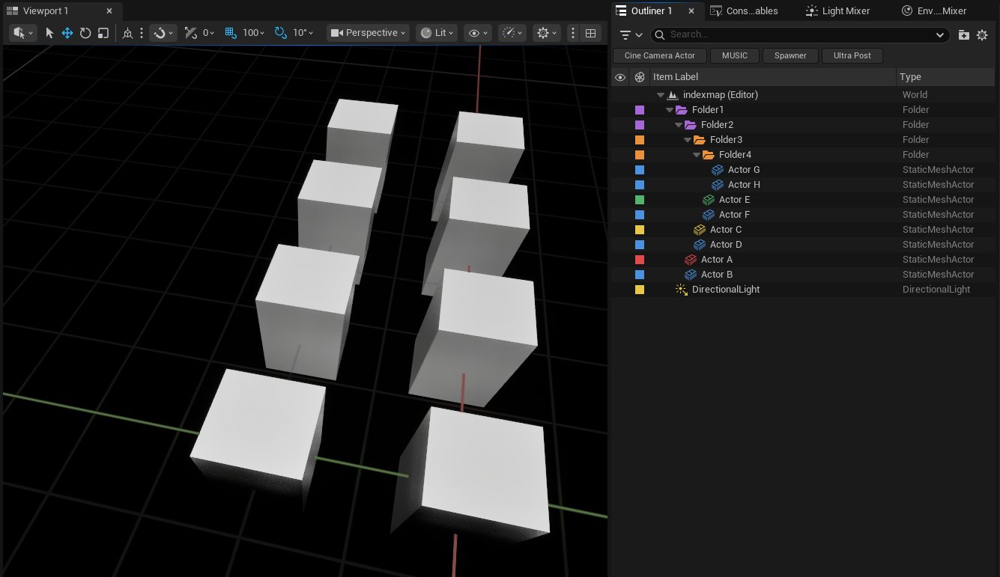
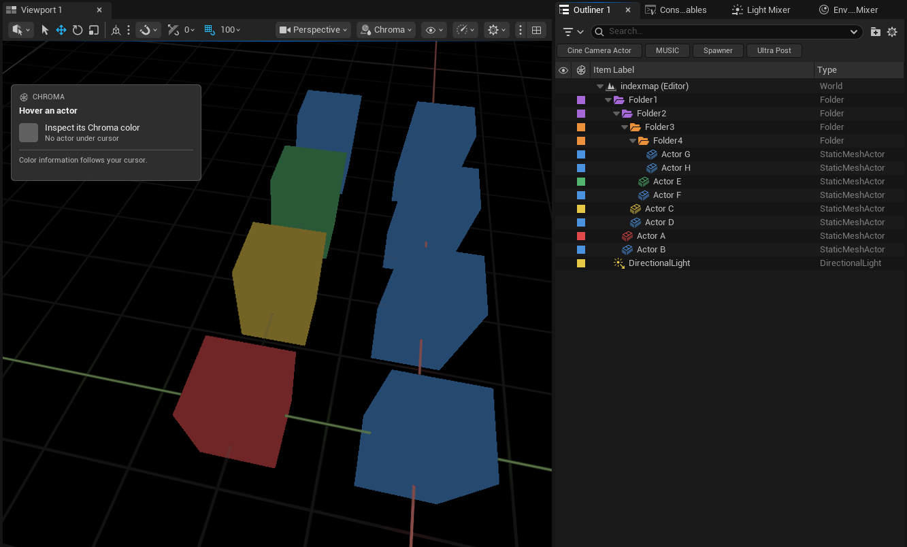

# Chroma

**World Outliner Color Organization for Unreal Engine**

**Make large levels easier to read, navigate, and understand at a glance.**

Chroma adds meaningful color organization to Unreal Engine's **World Outliner**. Give Actors and Folders recognizable colors, inherit them through folder hierarchies, select related content by color, and see your organization in the viewport—all without changing the gameplay or materials of the content you're working on.

    

  

---

## Your level should be easier to understand

Large World Outliners can become difficult to scan. Folders tell you where Actors belong, and names describe what they are, but neither makes it easy to visually separate gameplay objects from environment art, lighting, audio, or content that needs attention.

**Chroma adds another layer of information without changing your level's structure.**

- **Recognize content at a glance.** Give Actors and Folders meaningful colors right in the Outliner.
- **Organize entire branches at once.** Folder colors flow down to nested folders and Actors, including new content added later.
- **Keep exceptions intentional.** Override a color for a specific item, clear the override to inherit again, or use No Color to stop inheritance.
- **Find related work faster.** Select loaded items by matching color—even when names and folders differ.
- **See the organization in your scene.** Use colored selection outlines and Actor Coloration to inspect supported geometry directly in the editor viewport.

  

## Explore the documentation

> ### [**Chroma Documentation — Full User Guide and Technical Reference**](https://mippi-the-dork.github.io/Chroma/)
>
> **Everything you need to learn and use Chroma, in one place.** Follow setup and first-use workflows, learn the exact color assignment and inheritance rules, explore selection and viewport tools, or look up saving, troubleshooting, and implementation details.
>
> **[Get Started](https://mippi-the-dork.github.io/Chroma/?page=01-getting-started%2FREADME.md)** · **[Colors & Inheritance](https://mippi-the-dork.github.io/Chroma/?page=02-colors-and-inheritance%2FREADME.md)** · **[Selection & Outliner](https://mippi-the-dork.github.io/Chroma/?page=03-selection-and-outliner%2FREADME.md)** · **[Viewport Presentation](https://mippi-the-dork.github.io/Chroma/?page=04-viewport%2FREADME.md)** · **[Settings & Support](https://mippi-the-dork.github.io/Chroma/?page=05-settings-and-support%2FREADME.md)**

The README is an overview of what Chroma offers. **The [documentation website](https://mippi-the-dork.github.io/Chroma/) is the maintained reference for exact behavior, installation, workflows, and technical details.**

## One color system. Several useful workflows.

All of Chroma's organizational features work through the same color assignments. Named project presets can represent your team's categories, while custom colors provide one-off exceptions.

| Capability | What it helps you do |
| --- | --- |
| **[Actor & Folder Colors](https://mippi-the-dork.github.io/Chroma/?page=02-colors-and-inheritance%2Fassign%2FDESIGN.md)** | Assign a color directly from a compact World Outliner swatch. |
| **[Named Project Palette](https://mippi-the-dork.github.io/Chroma/?page=02-colors-and-inheritance%2Fpalette%2FDESIGN.md)** | Give colors consistent names and identities that stay connected when a preset is renamed or recolored. |
| **[Folder Inheritance](https://mippi-the-dork.github.io/Chroma/?page=02-colors-and-inheritance%2Finheritance%2FDESIGN.md)** | Color a whole folder hierarchy automatically, including newly added Actors. |
| **[Overrides & No Color](https://mippi-the-dork.github.io/Chroma/?page=02-colors-and-inheritance%2Foverrides%2FDESIGN.md)** | Make exceptions without losing the ability to return to an inherited color. |
| **[Custom & Used Colors](https://mippi-the-dork.github.io/Chroma/?page=02-colors-and-inheritance%2Fcustom-and-used%2FDESIGN.md)** | Pick an individual RGB color or reuse one already present in loaded level content. |
| **[Multi-Selection Editing](https://mippi-the-dork.github.io/Chroma/?page=03-selection-and-outliner%2Fbatch%2FDESIGN.md)** | Apply a color to compatible selected Actors and Folders with one action. |
| **[Matching Selection](https://mippi-the-dork.github.io/Chroma/?page=03-selection-and-outliner%2Fmatching%2FDESIGN.md)** | Select loaded content sharing a named preset or custom color, across the level or among siblings. |
| **[Copy & Paste](https://mippi-the-dork.github.io/Chroma/?page=03-selection-and-outliner%2Fclipboard%2FDESIGN.md)** | Reuse assignments while preserving named preset identity. |
| **[Tinted Outliner Icons](https://mippi-the-dork.github.io/Chroma/?page=03-selection-and-outliner%2Ficon-tint%2FDESIGN.md)** | Display effective colors on compatible native Actor and Folder icons. |
| **[Colored Selection Outlines](https://mippi-the-dork.github.io/Chroma/?page=04-viewport%2Foutlines%2FDESIGN.md)** | Identify differently colored selected Actors right in the viewport. |
| **[Actor Coloration](https://mippi-the-dork.github.io/Chroma/?page=04-viewport%2Fvisualization%2FDESIGN.md)** | View supported level geometry in its effective organizational color instead of its normal material appearance. |
| **[Viewport Color Inspector](https://mippi-the-dork.github.io/Chroma/?page=04-viewport%2Finspector%2FDESIGN.md)** | Hover supported geometry to see the Actor, its color, and where that color came from. |

Chroma stores **editor organization metadata**, not replacement materials or runtime color Components.

## Useful in real production workflows

### Organize a whole level without coloring every Actor

Give an **Environment** folder Green and **Gameplay** Orange. Actors inherit their containing folder's color, including new Actors added later. Give an important objective a Red override, then use **Clear Override** whenever it should return to its folder's color.

  

### Select related objects without relying on names

Need every loaded Gameplay-colored Actor, even across different folders? Choose **Select Matching Color**. Restrict the operation to siblings when you only want the matching content under the same immediate Outliner parent.

  

### See your organizational structure in the viewport

Change the viewport from Lit to **Actor Coloration → Chroma** to display supported geometry using its effective color. Hover an Actor to inspect its assignment. Switch back to Lit when you're finished—your materials haven't changed.

| Normal Lit view | Chroma Actor Coloration |
| :---: | :---: |
|  |  |

### Make selected Actors recognizable

Color-coded selection outlines make it easier to distinguish selected content in the viewport. Chroma supports up to **six additional distinct outline colors** when compatible renderer slots are available.

  

[**Explore the viewport tools and their limitations →**](https://mippi-the-dork.github.io/Chroma/?page=04-viewport%2FREADME.md)

## Get Chroma

**Chroma v1.0.1** targets **Unreal Engine 5.8.x on Windows 64-bit** and runs in the **Editor only**. The current repository reports testing on **UE 5.8.2**.

Install from a compatible prebuilt release if one is available, use Fab when Chroma is listed there, or build the source as an Unreal Editor plugin. A GitHub-generated source ZIP is not necessarily a precompiled plugin.

**[GitHub Releases](https://github.com/mippi-the-dork/Chroma/releases)** · **[Installation Guide](https://mippi-the-dork.github.io/Chroma/?page=01-getting-started%2Finstall%2FDESIGN.md)** · **[First Color Workflow](https://mippi-the-dork.github.io/Chroma/?page=01-getting-started%2Ffirst-use%2FDESIGN.md)**

## Important limitations

Chroma is an **editor organization utility**, not a runtime rendering system, replacement hierarchy, or source-control tool.

- **Loaded content only.** Color editing, matching selection, and used-color collection do not include unloaded World Partition Actors.
- **Folder inheritance is not attachment inheritance.** Attached Actors don't automatically inherit a parent Actor's color; containing Outliner folders determine inherited color.
- **Clear Override and No Color are different.** Clearing removes a direct assignment and resumes folder inheritance; No Color intentionally blocks it.
- **Outliner filters affect Folder selection.** Chroma may select filtered-out matching Actors, but hidden matching Folder rows cannot always be selected safely.
- **Viewport features have rendering limits.** Selection outlines use up to six extra distinct colors when slots are free. Specialized rendering paths, custom icon widgets, translucency, Landscapes, and per-instance editing may behave differently.
- **No packaged-game Chroma runtime.** Organizational colors do not replace materials, move Actors, change gameplay visibility, or affect the packaged game's visuals.
- **Save and share your changes normally.** Actor and Folder assignments belong to editor packages; named project colors belong to Chroma project configuration. Chroma does not perform Perforce checkouts, submissions, merges, or synchronization.

For more detail, see [Troubleshooting and FAQ](https://mippi-the-dork.github.io/Chroma/?page=05-settings-and-support%2Ftroubleshooting%2FDESIGN.md) and [Saving and Team Workflows](https://mippi-the-dork.github.io/Chroma/?page=05-settings-and-support%2Fsaving%2FDESIGN.md).

## What's next?

Chroma's current documented release is **v1.0.1**. No additional feature set or next major version has been committed in the roadmap. Future work and validation priorities will be documented as plans develop, without presenting them as shipped features.

[**View the Chroma Roadmap →**](https://mippi-the-dork.github.io/Chroma/?page=ROADMAP.md)

## Issues, feature requests and contributions

Found a bug? Please [open an issue](https://github.com/mippi-the-dork/Chroma/issues) with your Chroma/Unreal versions, installation method, affected Actor or Folder setup, steps to reproduce, and screenshots, video or Output Log excerpts where useful. For color inheritance problems, include the relevant Outliner folder hierarchy.

Have an idea? [Submit a feature request](https://github.com/mippi-the-dork/Chroma/issues) describing the organization problem you'd like to solve and the outcome you're after.

**Pull requests are welcome.** For significant changes, open an issue first so the intended scope can be discussed. Chroma aims to stay compact, understandable, and native to Unreal's existing editor workflows.

## License

Chroma is distributed under the **MIT License**. See [LICENSE](LICENSE) for the full terms.

---

**Chroma is created by Mippi the Dork.**

**[Explore the Documentation](https://mippi-the-dork.github.io/Chroma/)** · **[Get Chroma](https://github.com/mippi-the-dork/Chroma/releases)** · **[Report an Issue](https://github.com/mippi-the-dork/Chroma/issues)**
