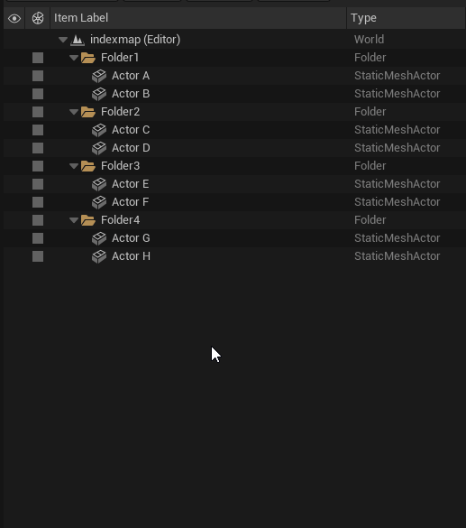

# Your First Color Workflow — Design

**Chroma v1.0.1 · User guide**

## Try Chroma on a disposable level

<!-- Media target: GIF | first-assign-workflow | docs/assets/media/first-assign-workflow.gif -->
<figure class="doc-media" data-kind="gif" data-media-id="first-assign-workflow">
  
  <figcaption>An initial Chroma workflow colors a folder, overrides an Actor, and then restores inherited color.
    <strong>Capture instructions · GIF:</strong> Record the World Outliner and viewport together: create or select an Environment folder, choose Green from its Chroma swatch, assign one child Actor Red, then use Clear Override to return it to inherited Green. Keep actions legible and the camera stationary.
  </figcaption>
</figure>

1. Open Unreal Editor and add two Static Mesh Actors under a new **Environment** folder in the World Outliner.
2. Click the Chroma color swatch on the **Environment** folder. Choose **Green** from the Project Palette.
3. Observe that the two child Actors acquire Green **effective** color without needing individual assignments.
4. Give one Actor a **Red** direct assignment. Its direct override now takes precedence.
5. Choose **Clear Override** for that Actor. It becomes Green again because the folder supplies its color.
6. Choose **No Color** instead. That Actor becomes intentionally uncolored even while it remains inside Environment.
7. Clear the No Color override if you want inheritance restored.
8. Save the level and relevant Actor/Folder packages using normal Unreal save commands.

## Where to find the palette

<figure class="doc-media" data-existing-media="Chroma-Assigning-Colors.gif">
  
  <figcaption>The Chroma swatch menu applies colors to Actors and Folders directly from the World Outliner.</figcaption>
</figure>

Chroma adds a narrow swatch column immediately before **Item Label**. Left-click its square swatch to open the full color menu. The menu shows the current effective color, **Used in This Level**, **Project Palette**, custom color and matching/copy actions.

Right-clicking the swatch opens a smaller action-oriented menu. Compatible Actors also have **Chroma → Color and Selection** in their context menu.

## See the same colors elsewhere

With **Tint Outliner Icons** enabled (default), compatible Actor and Folder icons follow their effective color. To inspect colors directly in the viewport, open the view-mode menu, normally **Lit**, and select **Actor Coloration → Chroma**. Return to Lit afterward.

## What to watch

Coloring an Outliner folder is not the same as attaching Actors to a parent Actor. New Actors in that folder inherit automatically. Unloaded World Partition Actors are not available for editor-side selection and coloring.

---

[Read Technical](TECHNICAL.md) for source implementation, native engine integration and data ownership.
