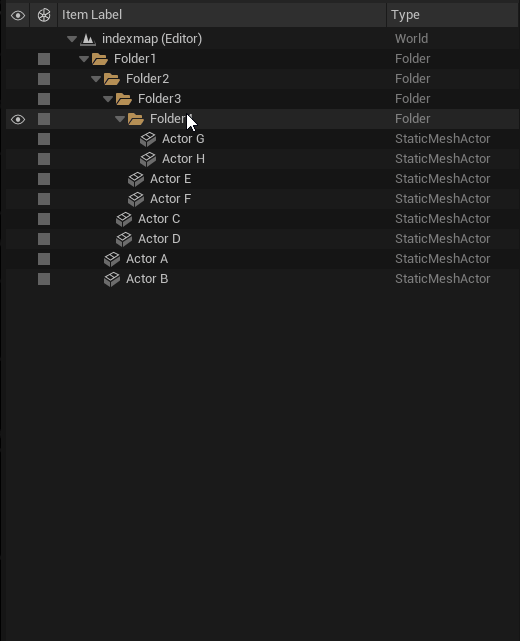

# Folder Inheritance — Design

**Chroma v1.0.1 · User guide**

## Folder colors act as defaults

Chroma first checks an Actor's own color assignment. If none exists, it searches the Actor's containing World Outliner Folder and then its parent folders. The first assignment found supplies the Actor's effective color.

For example:

```text
Environment              Green (direct Folder)
├── Walls                inherits Green
│   └── Wall_A           inherits Green
├── Props                inherits Green
│   └── Table            inherits Green
└── Lighting             Yellow (override Folder)
    └── Lamp             inherits Yellow
```

## New Actors inherit automatically

<figure class="doc-media" data-existing-media="Chroma-Inheritance.gif">
  
  <figcaption>An Actor uses the nearest containing Folder’s effective color until a direct assignment overrides it.</figcaption>
</figure>


Adding an Actor to an existing colored folder makes its effective color resolve from that folder. The color is not copied onto the Actor as a permanent direct assignment. The same holds for newly created nested folders without an override.

## Attachments do not create inheritance

A red parent Actor does **not** make an attached child Actor red by attachment alone. Chroma's inheritance traverses World Outliner folder paths. The child may still share a folder and inherit the folder's color, but its transform-attachment relationship is not the cause.

## Changing branches

Assign a different color to a nested Folder to create an independent branch. Move an unassigned Actor into a different colored Folder and its effective color changes based on its new folder. Give an Actor a direct override when it should retain its own color regardless of the folder.

## Inspect the source

Hover a Chroma swatch or use the viewport inspector to identify an inherited assignment and its source.

---

[Read Technical](TECHNICAL.md) for source implementation, native engine integration and data ownership.
