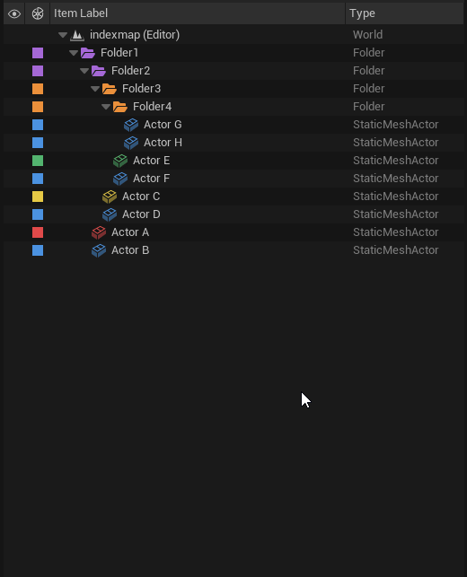

# Matching Selection — Design

**Chroma v1.0.1 · User guide**

## Select Matching Color

Choose **Select Matching Color** from an Actor or Folder's Chroma menu to select loaded items with the same effective Chroma assignment across the editor world. This is useful when organizational colors have meaningful names such as Gameplay or Lighting.

Named presets match by their **identity**, not RGB appearance. Two different named presets that look exactly alike remain separate groups. Custom colors match through their stored value.

## Select Matching Color Among Siblings

This command restricts the match to items with the same immediate World Outliner parent. For example, among Gameplay triggers it can select only Orange siblings without collecting Orange items from unrelated folders.

## Shift adds rather than replaces

<figure class="doc-media" data-existing-media="Chroma-Matching.gif">
  
  <figcaption>Matching selection gathers related loaded Actors based on the stored Chroma assignment.</figcaption>
</figure>

Hold **Shift** when invoking either matching-selection command to add matches to your current selection. Without Shift, the command performs a matching selection in the appropriate scope.

## A practical workflow

Color all gameplay triggers with a **Gameplay Trigger** preset. Choose an example trigger, run **Select Matching Color**, then edit the resulting loaded Actors in another Unreal tool.

## Matching uncolored items

Current matching treats items that **both resolve to no visible color** as matching. That means an explicit **No Color** item and an item with no direct assignment can belong to the same colorless matching result. Use a named preset if you need a separate, reliably selectable organizational group.

For **Select Matching Color Among Siblings**, immediate Outliner parent means the attachment parent for an attached Actor, or its containing Folder otherwise. This selection-scope rule is separate from Folder-only color inheritance.

## Filtering and unloaded content

Chroma enumerates **loaded** items even if an Actor is filtered from the visible Outliner. It can still select those Actors. Filtered-out **Folder** rows cannot always be selected safely: Chroma notifies you to clear the Outliner filter. Unloaded World Partition Actors cannot be selected by this operation.

---

[Read Technical](TECHNICAL.md) for native Unreal integration, data ownership and implementation limits.
