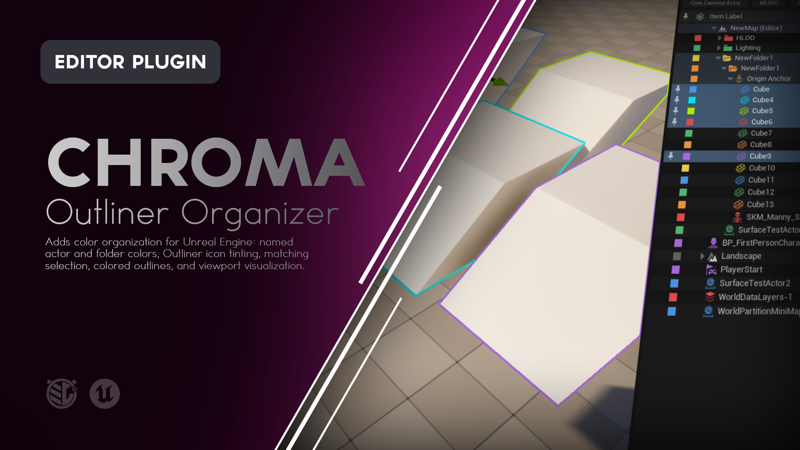

# Chroma Documentation

**Chroma v1.0.1 · Unreal Engine 5.8.x · Win64 · Editor-only**

Chroma makes **color a useful layer of Unreal Editor organization**. Assign named project colors or custom colors to Actors and World Outliner folders, inherit folder colors automatically, select related level content, and display assignments directly in the Outliner or viewport.

*Chroma brings color-based organization to the World Outliner and viewport without changing gameplay materials or packaged rendering.*

## What can I do with Chroma?

**Color an entire folder once.** Loaded and newly added Actors inherit their containing folder's effective color unless they have their own override. Nested folders can introduce different colors for their branches.

**Select by meaning.** Use a named project color such as *Gameplay* to find matching loaded Actors, including ones filtered out of the current Outliner view.

**See organization in context.** Tint compatible native Outliner icons and selection outlines, or switch to **Actor Coloration → Chroma** to visualize supported geometry according to its effective color.

**Keep shared colors consistent.** A named preset has a stable identity: rename or recolor it in Project Settings and existing assignments continue pointing to that same preset.

## Get started in three steps

1. [Install Chroma](01-getting-started/install/DESIGN.md) for your compatible Unreal Engine editor.
2. [Assign your first colors](01-getting-started/first-use/DESIGN.md) through the swatches next to World Outliner rows.
3. [Learn inheritance](02-colors-and-inheritance/inheritance/DESIGN.md) before creating a complex palette or applying overrides.

## Choose the right documentation

The **Design** guide for each topic describes real controls, intended workflows, outcomes and limitations. The **Technical** companion covers source implementation, data ownership, native Unreal integration and debugging. Neither requires reading the other just to understand its own subject.

## Explore the manual

| Category | Topics | What you'll learn |
| --- | ---: | --- |
| [01. Getting Started](01-getting-started/README.md) | 3 | Installation, first use, and what Chroma changes. |
| [02. Colors and Inheritance](02-colors-and-inheritance/README.md) | 5 | How Chroma assigns, resolves, and manages colors. |
| [03. Selection and Outliner](03-selection-and-outliner/README.md) | 4 | Color-aware selection and Outliner presentation. |
| [04. Viewport Presentation](04-viewport/README.md) | 3 | See Chroma assignments directly while working in a level. |
| [05. Settings, Saving and Support](05-settings-and-support/README.md) | 5 | Shared settings, persistence, limitations, and troubleshooting. |

## Before you share colors with a team

Chroma assignments are **editor package metadata**, not a runtime Component. Named presets and preferences are stored through project configuration. Save the affected Actor, Folder or level packages and relevant configuration when sharing color organization through Perforce or other source control. Chroma does not check files out or submit them automatically.

## Documentation media and verification

Chroma's existing editor screenshots and GIFs appear throughout this manual. Planned visuals use a neutral placeholder with two lines below it: a reader-facing explanation and **specific Image/GIF capture instructions** describing exactly what should appear in the replacement.

The [Media Inventory](MEDIA_INVENTORY.md) lists all 35 planned captures and filenames. The [Documentation Audit](DOCUMENTATION_AUDIT.md) tracks remaining work, while the [Verification Matrix](VERIFICATION_MATRIX.md) records tests that still require actual Unreal Editor or browser results.

## Important boundaries

Chroma only edits **loaded content** in ordinary editor worlds; unloaded World Partition Actors are excluded from matching, editing and used-color collection. Attachment relationships are not folder inheritance. Selection outlines can display at most six extra colors when slots are available. Viewport coloration is an editor view mode and doesn't change materials or packaged output.

## Project and future updates

[Chroma source](https://github.com/mippi-the-dork/Chroma) · [Releases](https://github.com/mippi-the-dork/Chroma/releases) · [Issues](https://github.com/mippi-the-dork/Chroma/issues) · [Roadmap](ROADMAP.md)

**Documentation basis:** Chroma v1.0.1 source and README. This site documents implemented features; live browser and full Unreal Editor test matrices are separate checks.
